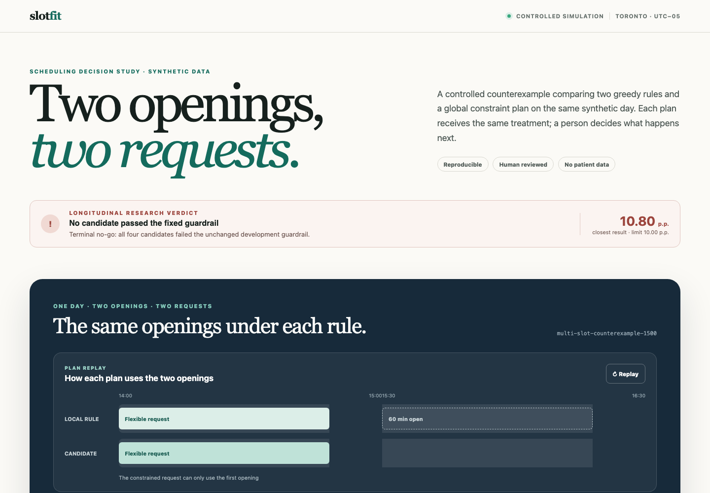
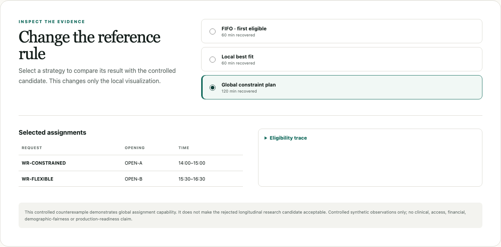
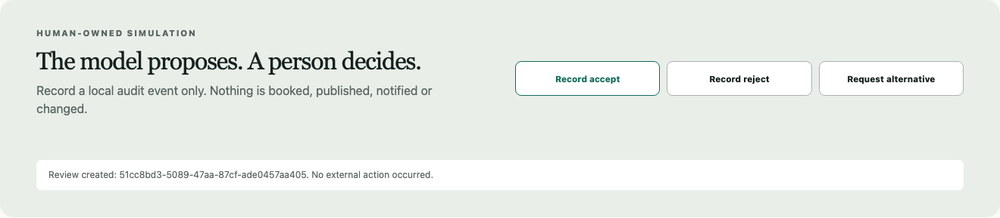

# SlotFit

A reproducible study of how a clinic could refill a cancelled appointment
without turning the decision into opaque automation. It compares two simple
rules with a constraint solver on entirely synthetic calendars, measures what
each one does to the people who keep getting left out, and ends with a
pre-declared no-go. There is no machine learning and no generative model in the
decision path.

- [The problem](#1-the-problem)
- [What the study asked](#2-what-the-study-asked)
- [The answer in one screen](#3-the-answer-in-one-screen)
- [How the experiment was built, stage by stage](#4-how-the-experiment-was-built-stage-by-stage)
- [Decisions and why](#5-decisions-and-why)
- [Evidence](#6-evidence)
- [Why constraint programming and not generative AI](#7-why-constraint-programming-and-not-generative-ai)
- [Layers](#8-layers)
- [Run it](#9-run-it)
- [Claim boundary](#10-claim-boundary)
- [Documentation map](#11-documentation-map)

## 1. The problem

I spent ten years building software for healthcare operations. In every
outpatient clinic I worked with, appointment scheduling was the place where
confusion gathered: a full agenda, a waiting list, and a morning phone call that
cancels the afternoon.

The pattern is always the same. Two cancellations open two gaps. Three people
are waiting, each with a constraint of their own: one can only come at a given
hour, one needs the longer visit, one needs a room that is closed today. The
front desk calls the list in the order people joined it and takes the first
match that works. That rule is easy to explain and easy to defend, and it
regularly leaves an hour empty while the person who could have used it is told
there is nothing available.

Nobody did anything wrong. The rule never looked at the whole afternoon.

This repository starts from that known problem. It uses no data from any
clinic. Every calendar, request and constraint is synthetic and generated by
the code in this repository.

## 2. What the study asked

Three questions, fixed before any code was written:

1. Does a rule that looks at the whole day together fill openings that the
   usual rules leave empty?
2. If it does, what happens over repeated days to the people with constraints,
   the ones the usual rules already tend to skip?
3. Can a person at the desk read why each placement was made, and keep the
   final decision?

Two rules were kept as baselines because they are what a front desk actually
does: first come, first served (FIFO), and local best fit (the request that
leaves the least slack in an opening). The candidate is a constraint solver
that takes every opening and every request together and returns a plan that is
proven best within the declared rules.

A rejection rule was declared before the first comparison ran: a candidate is
rejected if the worst supported group of requests ends up more than 10
percentage points worse off than under the better baseline, even if it fills
more minutes.

## 3. The answer in one screen

The local application shows the counterexample and, above it, the verdict of
the longitudinal study. Every screenshot in this README is produced by
[`web/tests/screenshots.spec.ts`](web/tests/screenshots.spec.ts) from the
running application.



On the fixture, the two greedy rules place one request and leave 60 of 120
minutes open. The constraint plan places both requests and recovers all 120
minutes. The same screen says, before anything else, that no candidate passed
the fixed guardrail in the longitudinal study.



Selecting a rule changes only the local visualization. Each assignment carries
its opening, its time and a trace of the eligibility reason codes.



The only write in the system is a simulated review event. It is stored in a
local append-only log and nothing is booked, published or notified.

## 4. How the experiment was built, stage by stage

The work followed a spec-driven lifecycle (AI-DLC): one active specification
at a time, a read-only preflight, the smallest failing test first, then
implementation, refactoring, `make verify`, recorded evidence and a human gate
before the next stage. Each stage below links to its specification, states the
decision taken at its gate and names the tests that pin its behaviour.

| Stage | Question | Decision at the gate | Tests |
|---|---|---|---|
| [SF-001](specs/001-domain-and-baselines.md) Domain and baselines | Can the day be modelled with immutable values and explicit eligibility reasons? | Six reason codes; FIFO and best fit as the only baselines; timezone-aware windows | `test_domain_and_strategies` |
| [SF-002](specs/002-scenarios-and-fairness-controls.md) Scenarios and controls | Can synthetic days be generated reproducibly, with audit attributes that never touch the decision? | Versioned generator with disjoint seed registries; audit-only slices; metamorphic tests for renamed IDs and shuffled input | `test_generation_and_invariance`, `test_evaluation` |
| [SF-003](specs/003-optimizer-and-evaluation.md) Optimizer and evaluation | Does a global plan beat the baselines, and does it pass the pre-declared guardrail? | CP-SAT with a lexicographic objective; four candidates V1 to V4 tested on 40 development seeds; **terminal no-go** | `test_cp_sat_optimizer`, `test_longitudinal`, `test_development_comparison` |
| [SF-004](specs/004-api-boundary.md) API boundary | Can the evidence be served read-only with a versioned schema? | FastAPI and Pydantic; `automatic_action: none` as a literal in the schema | `test_api_contract` |
| [SF-005](specs/005-persistence-and-review.md) Persistence and review | Can a human decision be recorded without any external effect? | Append-only SQLite log with idempotency keys | `test_review_persistence`, `test_review_api` |
| [SF-006](specs/006-comparison-ui.md) Comparison UI | Can two plans be shown with the same visual treatment and no promotional claim? | Vue with a hand-written time grid; neutrality test; axe checks | `web/tests/main-flow.spec.ts` |
| [SF-007](specs/007-frozen-evaluation-gate.md) Frozen evaluation | Did any candidate earn the final held-out run? | No. The final set was never opened | — |
| [SF-008](specs/008-hardening-and-communication.md) Hardening and communication | Can the result be reproduced and communicated without crossing the claim boundary? | Locked runbook; publication-contract tests on every public text | `test_publication_contract` |
| [SF-009](specs/009-governance-reconciliation.md) Governance reconciliation | Do docs, tests and UI agree before a second cycle? | Calendar library removed; one shared style for every plan | `make verify` |
| [SF-010](specs/010-clinic-day-fixture-and-explanations.md) Clinic-day fixture and explanations | Can the story be told from the same engine, with a plain sentence for every reason code? | Display-only day context barred from decision modules by a source-scan test | `test_clinic_day_story`, `test_explanations` |
| [SF-015](specs/015-code-organization-and-experiment-narrative.md) Code organization and narrative | Can the code and the README be read as a study? | Behaviour-preserving refactors; screenshots generated, never taken by hand | all of the above |

Stage SF-003 is the heart of the study and the only stage with a negative
result. Its four candidates are described in
[`docs/development-evidence.md`](docs/development-evidence.md) and the reason
there is no fifth in
[`docs/methodology-no-go-review.md`](docs/methodology-no-go-review.md).

## 5. Decisions and why

- **Baselines first.** The usual rules are implemented, tested and shown with
  the same treatment as the candidate, so the comparison is against what a
  front desk does today, not against a strawman.
- **Hard constraints are never penalties.** Room, provider, duration, notice
  and consent decide eligibility; they are not weighed against minutes. A plan
  that breaks one is invalid, not expensive.
- **Audit attributes stay out of the objective.** Groups used to measure
  repeated exclusion (availability band, notice band and similar) are joined
  after planning. No strategy can see them, and a source-scan test keeps it so.
- **The rejection rule was fixed before the first run.** When V4 came within
  0.80 of the limit, the limit stayed. Moving it would have manufactured an
  acceptance.
- **No fifth candidate.** Another objective change on the same 40 seeds would be
  post-hoc tuning. The honest next step is a new research line with a new
  development distribution.
- **A person owns every decision.** The API exposes plans and reasons; the only
  write is a review event; the schema carries `automatic_action: none`.
- **Constraint programming, not a learned model.** The problem has discrete
  variables, known hard constraints and declared objectives. That structure is
  what a solver is for. See section 7.

## 6. Evidence

Counterexample fixture (`multi-slot-counterexample-1500`, two openings of 60
minutes, two requests):

| Rule | Minutes recovered | Requests placed |
|---|---:|---:|
| FIFO | 60 | 1 |
| Local best fit | 60 | 1 |
| CP-SAT plan | 120 | 2 |

Longitudinal development comparison (40 registered seeds, 10 synthetic
requests and 3 openings per seed, 5 compatible-opportunity rounds):

| Strategy | Mean utilization | Mean requests served | Starvation K=3 | Hard violations |
|---|---:|---:|---:|---:|
| FIFO | 72.01% | 2.200 | 3.57% | 0 |
| Local best fit | 76.46% | 2.275 | 2.98% | 0 |
| CP-SAT V1 | 96.81% | 2.700 | 0.00% | 0 |

Guardrail results for the four candidates (limit: +10.00 percentage points of
exposure-shortfall degradation on the worst supported slice):

| Candidate | Idea | Utilization | Worst supported degradation | Decision |
|---|---|---:|---:|---|
| V1 | static lexicographic optimum | 96.81% | +12.58 p.p. | rejected |
| V2 | prior compatible-opportunity debt | 96.81% | +12.58 p.p. | rejected |
| V3 | label-free placement scarcity | 96.81% | +12.35 p.p. | rejected |
| V4 | 90% per-round recovery floor | 95.71% | +10.80 p.p. | rejected |

Every candidate produced zero hard-constraint violations and zero plan changes
when identifiers were renamed or input order was reversed. All three solver
phases returned `OPTIMAL` on all 40 seeds. The final frozen evaluation set was
never opened because no candidate earned it.

These are controlled observations on a synthetic distribution. They describe
schedule behaviour only.

## 7. Why constraint programming and not generative AI

The decision has structure: discrete variables (request × opening), hard
constraints that are known in advance, and objectives a clinic can state. For
that structure a constraint solver (OR-Tools CP-SAT) gives what a generative
model does not: the same plan for the same input, a proof that no better plan
exists within the declared model, a hard rejection of invalid assignments, and
an explanation made of stable reason codes rather than plausible prose. It also
needs no training data, which matters for a clinic that has none.

Generative models could help at the edges of this workflow, for example to
draft the message a coordinator sends. They were left out because there is no
language problem in the decision path. The lesson the study was built to show
is older than the current wave: much of what is pitched as AI today is a
scheduling, routing or matching problem, and classic algorithms already solve
those well, predictably and explainably.

This is design rationale, not a measured result.

## 8. Layers

```text
Vue UI  ──HTTP──►  FastAPI routes + Pydantic schemas  ──►  api_service (mapping)
                                                              │
                 CLI and research scripts ────────────────────┤
                                                              ▼
                       strategies (FIFO, best fit)  ·  optimizer (CP-SAT adapter)
                                                              │
                                     eligibility (reason codes)  ·  explanations
                                                              │
                                   domain (frozen values)  ·  day_context (display only)

                 persistence (SQLite review log)  ◄──  FastAPI POST /reviews only
```

Dependencies point inward. The domain imports only the standard library;
OR-Tools appears only in the optimizer adapter; FastAPI and Pydantic only at
the boundary; SQLite only in persistence. The layer description and one
decision traced end to end are in
[`docs/architecture.md`](docs/architecture.md).

## 9. Run it

Requires `uv`, Python 3.12, Node.js and npm. The full local runbook is in
[`docs/demo-runbook.md`](docs/demo-runbook.md).

```bash
make verify              # 98 Python tests, API smoke, typed web build, Playwright + axe
make demo                # the fixed teaching fixture
make multi-slot-demo     # the global-conflict counterexample
make longitudinal-demo   # three controlled rounds for both baselines
make development-report  # the full 40-seed development comparison (JSON)
```

To open the application: start the API with
`uv run --python 3.12 uvicorn slotfit.api:app --app-dir src --port 8000`, then
`npm --prefix web run dev`, and visit the Vite URL. The Playwright configuration
starts both for the tests.

## 10. Claim boundary

Synthetic data only. No message is sent, no appointment is booked, no clinical
urgency is inferred, and no real scheduling system is touched. The results
describe the controlled simulation and are not evidence of recovered revenue,
reduced no-shows, patient benefit, demographic fairness or production
readiness. The solver's `OPTIMAL` proves optimality within the declared model
of a fixture; it does not prove that a plan is right, safe or just. A human
owns every simulated scheduling choice.

## 11. Documentation map

- Problem and method: [`docs/problem.md`](docs/problem.md),
  [`aidlc-docs/requirements.md`](aidlc-docs/requirements.md),
  [`aidlc-docs/execution-plan.md`](aidlc-docs/execution-plan.md),
  [`aidlc-docs/refinement-plan-2026-10.md`](aidlc-docs/refinement-plan-2026-10.md)
- Specifications, in order: [`specs/README.md`](specs/README.md)
- Architecture and decisions: [`docs/architecture.md`](docs/architecture.md),
  [`docs/adr/0001-modular-monolith-and-baselines.md`](docs/adr/0001-modular-monolith-and-baselines.md),
  [`docs/adr/0002-lexicographic-cp-sat.md`](docs/adr/0002-lexicographic-cp-sat.md),
  [`docs/adr/0003-local-sqlite-review-log.md`](docs/adr/0003-local-sqlite-review-log.md)
- Evidence: [`docs/development-evidence.md`](docs/development-evidence.md),
  [`docs/methodology-no-go-review.md`](docs/methodology-no-go-review.md),
  [`docs/alternative-plan-diagnostic.md`](docs/alternative-plan-diagnostic.md),
  [`docs/exposure-frontier.md`](docs/exposure-frontier.md)
- Bias and risk: [`docs/fairness-and-bias-plan.md`](docs/fairness-and-bias-plan.md),
  [`docs/risk-review.md`](docs/risk-review.md)
- Learning cards per stage: [`docs/bolts/README.md`](docs/bolts/README.md)
- Communication drafts: [`docs/video-script-en.md`](docs/video-script-en.md),
  [`docs/video-script-pt.md`](docs/video-script-pt.md),
  [`docs/linkedin-post-en.md`](docs/linkedin-post-en.md),
  [`docs/linkedin-post-pt.md`](docs/linkedin-post-pt.md)
- [`SECURITY.md`](SECURITY.md), [`LICENSE`](LICENSE)
