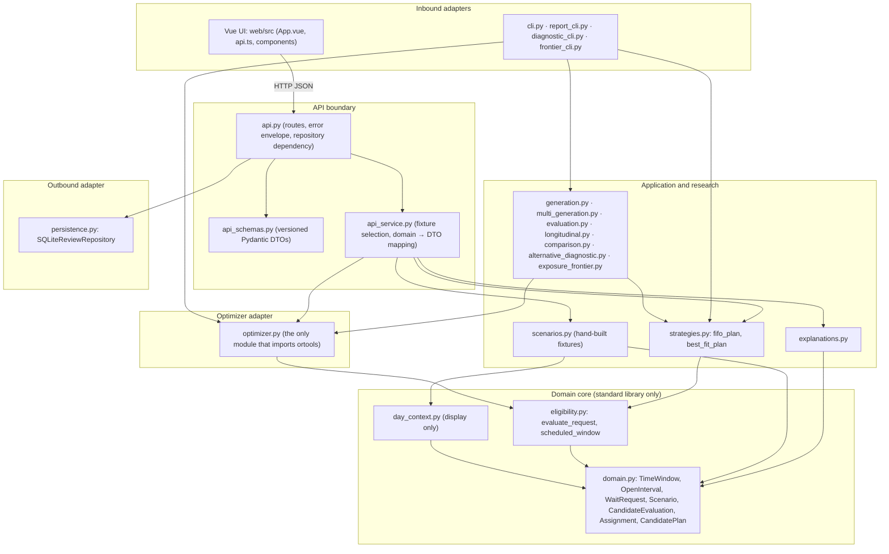

# Architecture

Current evidence-backed flow:

```text
single- or multi-slot scenario
  -> immutable domain objects
  -> eligibility evaluation
  -> chronological FIFO or best-fit strategy
  -> candidate plan
  -> CLI JSON output
```

Current read-only application boundary:

```text
FastAPI GET route
  -> versioned Pydantic response schema
  -> API service adapter
  -> existing synthetic fixture + strategy boundary
  -> explainable plans or checked-in research decision
  -> automatic_action: none
```

Current simulated-review flow:

```text
versioned POST review command
  -> Pydantic validation
  -> SQLite transaction + unique idempotency key
  -> immutable review event
  -> external_action: none
```

Current optimizer boundary:

```text
multi-slot scenario
  -> shared eligibility evaluations
  -> CP-SAT eligible-pair variables
  -> recovered minutes (phase 1)
  -> requests served (phase 2)
  -> wait-age tie-break (phase 3)
  -> structured plan + phase evidence
```

Current interactive application flow:

```text
Vue calendar
  -> FastAPI/Pydantic
  -> eligibility service
  -> FIFO | best-fit | CP-SAT
  -> explanation builder
  -> human review
  -> SQLite audit event
```

## Layers

Dependencies point inward. Nothing below a line imports anything above it.



### Domain core

Immutable value objects and the eligibility rules. Every class is a frozen
dataclass; `TimeWindow` rejects naive datetimes and inverted ranges, `Scenario`
rejects duplicate identifiers and duplicate join orders. `eligibility.py` is the
only producer of reason codes (`NO_COMMUNICATION_CONSENT`,
`PROVIDER_NOT_ELIGIBLE`, `REQUIRED_ROOM_UNAVAILABLE`, `DURATION_EXCEEDS_INTERVAL`,
`INSUFFICIENT_NOTICE`, `REQUEST_NOT_AVAILABLE`); it returns an evaluation for
every request/opening pair and never filters silently. `day_context.py` holds
booked blocks, cancellations and closed rooms for display and is barred from
the decision modules by a source-scan test. Imports: standard library and
`slotfit.domain` only. Tests: `test_domain_and_strategies`,
`test_clinic_day_story`, `test_generation_and_invariance`.

### Application and research

`strategies.py` implements both greedy baselines through one template: evaluate
every pair, walk the openings in time order, assign each request at most once.
FIFO orders candidates by join order; best fit by leftover minutes, then join
order. `explanations.py` maps each reason code to one sentence a coordinator
can read. `scenarios.py` builds the hand-made fixtures. The research modules
generate seeded days with audit-only slices, replay compatible-opportunity
rounds, and compute the guardrails. They import the domain, the strategies and
the optimizer, never the API or persistence. Tests: `test_multi_slot_baselines`,
`test_explanations`, `test_evaluation`, `test_longitudinal`,
`test_development_comparison`, `test_alternative_diagnostic`,
`test_exposure_frontier`, `test_multi_slot_generation`.

### Optimizer adapter

`optimizer.py` wraps OR-Tools CP-SAT. It computes eligibility with the same
`evaluate_request` the baselines use, creates one boolean variable per eligible
pair, constrains each request and each opening to at most one use, and solves
the objectives in lexicographic order: recovered minutes, requests served,
optional candidate-specific terms, then the wait-age tie-break, fixing each
phase's optimum before the next. It returns a domain `CandidatePlan` inside an
`OptimizationResult` that reports every phase status; `optimized` is true only
when all phases are `OPTIMAL`. ADR: `adr/0002-lexicographic-cp-sat.md`. Tests:
`test_cp_sat_optimizer`.

### API boundary

`api.py` holds the routes, the error envelope and the repository dependency.
`api_schemas.py` holds the versioned DTOs with literal guards such as
`synthetic: Literal[True]`, `automatic_action: Literal["none"]` and
`candidate_accepted: Literal[False]`. `api_service.py` chooses the fixture and
the strategies and maps domain values to DTOs, attaching the plain-language
explanations. FastAPI and Pydantic are imported only here. Tests:
`test_api_contract`, `test_review_api`, `make api-smoke`.

### Outbound adapter

`persistence.py` writes immutable review events to SQLite inside a transaction
keyed by an idempotency key: replaying a key returns the stored event, reusing it
for a different review raises a conflict. It imports only the standard library.
ADR: `adr/0003-local-sqlite-review-log.md`. Tests: `test_review_persistence`.

### Inbound adapters

`cli.py` prints the demos as JSON; the three research CLIs are thin wrappers
over `comparison`, `alternative_diagnostic` and `exposure_frontier`. The Vue UI
talks only over HTTP (`web/src/api.ts`) and is covered by
`web/tests/main-flow.spec.ts` and the screenshot script.

## One decision, end to end

`GET /api/v1/demos/clinic-day`:

1. `api.demo` receives the identifier and calls `api_service.get_demo`.
2. `get_demo` calls `scenarios.clinic_day_story(seed=1600)`, which reuses the
   two openings and two requests of the 1500 counterexample, adds a request
   that needs the closed Room B, and builds a `Scenario` plus a display-only
   `DayContext`.
3. `optimizer.optimize_plan` runs: `eligibility.evaluate_request` produces the
   reason codes for every pair (the Room B request fails with
   `REQUIRED_ROOM_UNAVAILABLE`), the three CP-SAT phases run, and a
   `CandidatePlan` with phase evidence comes back.
4. `strategies.fifo_plan` and `strategies.best_fit_plan` run on the same
   scenario with the same eligibility function.
5. `api_service._demo_response` builds the DTO: `synthetic=True`,
   `automatic_action="none"`, every plan with its assignments, and for every
   evaluation the sentences from `explanations.explain_evaluation`; the
   optimizer evidence and the day context are mapped alongside.
6. The response carries `research_candidate_accepted=False` and the
   counterexample disclosure; the full longitudinal verdict lives on its own
   route, `GET /api/v1/research/development-decision`.
7. FastAPI validates the result against `DemoResponse` and serializes it.
   Unknown identifiers return a 404 envelope. Determinism across repeated calls
   is pinned by `test_api_contract`.

## GRASP roles

| Role | Where |
|---|---|
| Information expert | `domain.TimeWindow` computes its own duration and containment; `Scenario` checks its own invariants; `eligibility.evaluate_request` holds every input the rule needs |
| Controller | the routes in `api.py` and `cli.main`: receive the event, delegate, map errors |
| Pure fabrication | `api_service` (mapping), `explanations` (copy table), `persistence.SQLiteReviewRepository`, `strategies._greedy_plan` |
| Protected variations | `optimizer` behind `OptimizationResult`/`CandidatePlan`; `api_schemas.SCHEMA_VERSION`; stable reason codes separated from changeable wording; the overridable repository dependency used by the API tests |

## Known leaks (documented, not yet fixed)

- The UI reads the global-conflict demo, not the clinic-day one, and computes a
  few numbers locally (recovered-minutes difference, the "closest result",
  the `/ 120 min` capacity label). It also labels a request "Constrained" or
  "Flexible" from its identifier. These belong to the story mode (SF-011) and
  the engine explorer (SF-013).
- The longitudinal verdict served by the API is a literal in `api_service.py`,
  not read from the comparison output; a drift test is a candidate for SF-013.
- The review repository is constructed at import time in `api.py` with a
  working-directory-relative path; a composition root would make the wiring
  explicit.

## Boundaries

- Domain objects do not import web, database or solver frameworks.
- Strategies receive a scenario and return a plan.
- Eligibility returns reason codes; it does not silently filter.
- Greedy strategies evaluate every request/interval pair and assign a request at
  most once.
- Persistence and HTTP are adapters around the domain.
- Planning/evidence routes remain read-only; the only POST appends a simulated
  human-review event and cannot mutate an external schedule.

## Failure stories

- Invalid time window: reject construction.
- No eligible request: return an empty plan with exclusions.
- Solver limit reached: return its explicit status and never report a baseline as
  the optimized plan.
- No feasible optimized plan: return `INFEASIBLE`; do not relax hard constraints.
